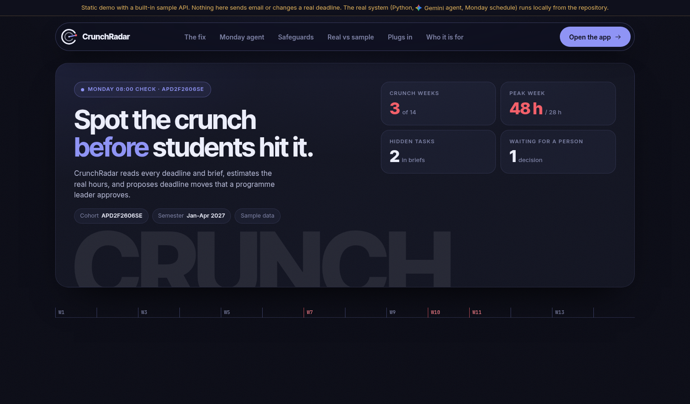
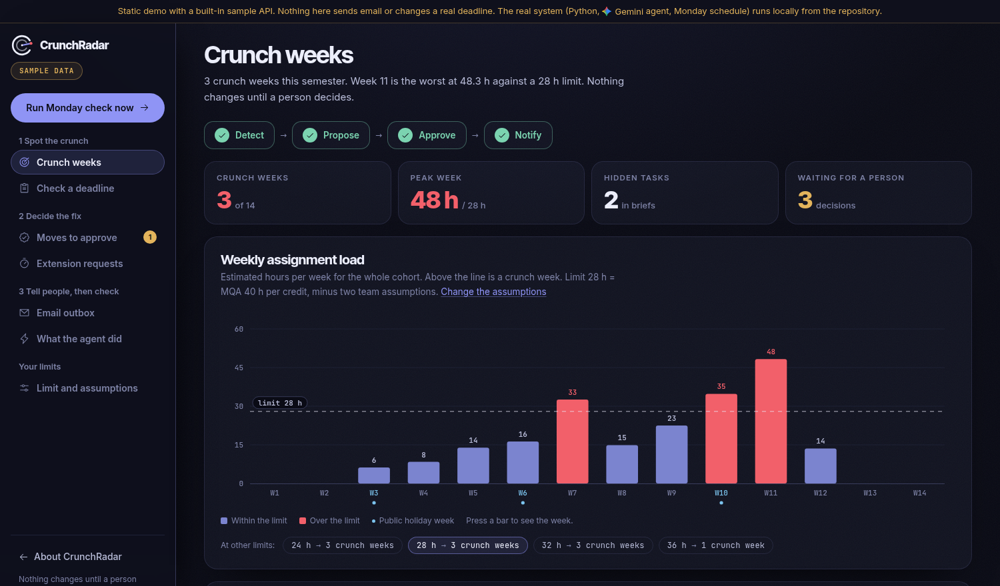

# CrunchRadar

**Spots crunch weeks before students hit them, and fixes them with a human in the loop.**

APU Cloud Innovation Hackathon 2026 · Theme: Intelligent Automation & Digital Transformation

> **The working system is in [`system/`](system/README.md)**: a rules engine and a Gemini agent that run on a Monday schedule, a human approval step, a follow-up check, MCP tools, and a React web app (68 backend and 57 frontend tests).

**▶ Live system: https://crunchradar-taupe.vercel.app** (the real Python backend on Vercel with the live Gemini agent, on the sample cohort. Saved state such as approvals and run history resets when the server restarts.)

## Start here

The app starts empty. Nothing appears in **Moves to approve**, **Email outbox** or **What the agent did** until the Monday check has run once.

1. Open **https://crunchradar-taupe.vercel.app** and press **Open the app**.
2. In the sidebar, press **Run Monday check now** and wait for it to finish (up to about 20 seconds).
3. Open **Moves to approve** to see the deadline moves the agent proposed.
4. Open **Email outbox** to read the approval email it drafted for the programme leader.
5. Open **What the agent did** to see the run step by step. A **GEMINI** badge means the Gemini agent planned it; a **RULES** badge means Gemini was busy or over its free quota and the rules planner took over.

If the lists are empty again later, the server has restarted: press **Run Monday check now** again.

The approval link inside the email is hidden in the app on purpose, because whoever holds it can approve the move. To try the approval page in this demo, open [`/docs`](https://crunchradar-taupe.vercel.app/docs), run `GET /outbox`, and open the `/approve/...` link from the newest approval email.





> **What this repo contains (13 Nov prototype round).** A working web prototype running on demo data. As the organisers announced, the prototype round does not need Gemini Enterprise, so this version is not built with it yet. If we reach the top 5, we will rebuild CrunchRadar as Gemini Enterprise workflow agents for the 17 Nov final. That plan is set out in [Plan for the final](#4-plan-for-the-final-17-nov-gemini-enterprise).

---

## About

Each lecturer sets deadlines for one module, so nobody sees the whole cohort's week. In our survey of 21 students, 18 had three or more deadlines or tests in their busiest week, and 20 had handed in work they knew was not their best because of clashes.

CrunchRadar reads the calendar feed and the assignment briefs, estimates the real hours, and finds the weeks that go over a sensible ceiling (MQA's 40 hours of student effort per credit, minus two assumptions we label). It then proposes a move the rules allow: never earlier, never a test, never a festive week. A named person approves it through a single-use link, and only then is the lecturer told.

An agent on the Gemini API plans the run through tool calls, and the rules stay in tested code, so the model can suggest but cannot decide. On our sample cohort, four approved moves take the peak week from 48 h to 32 h.

It is a prototype, and we would rather say so plainly: the cohort data is a labelled sample, email goes to an outbox, and Gemini Enterprise is the next step, not something we have used. What we can show is a working loop, 125 automated tests, and a design that never moves a deadline without a person.

## 1. The problem

Each lecturer sets deadlines on Moodle for their own module, without seeing the other modules. So a cohort gets 4–5 assignments and tests in the same week, then nothing for weeks.

- **Crunch weeks.** Quality drops and stress rises when several big tasks land together.
- **Hidden tasks.** Presentations and vivas are written inside assignment briefs but never appear on the Moodle calendar.
- **Festive weeks.** Deadlines land during Chinese New Year or Hari Raya.
- **No time for feedback.** The next assignment is due before marks on the last one come back.

Nobody owns the whole cohort's calendar, so nobody sees the overload until students are already in it.

## 2. The solution

CrunchRadar measures **hours of work per week**, not just the number of deadlines. It reads each assignment brief, estimates the effort, spreads that work over the weeks before the deadline, and compares the weekly total with a limit.

**How the limit is set.** The limit comes from Malaysia's Student Learning Time rule (MQA: 1 credit = 40 hours of student effort):

| | |
| --- | --- |
| 21 credits × 40 h | 840 h per semester |
| Spread over 14 weeks | ≈ 60 h per week |
| Minus classes | − 20 h |
| Minus revision and reading | − 12 h |
| **Assignment work limit** | **≈ 28 h per week** |

When a week goes over the limit, CrunchRadar proposes pushing one deadline 1–2 weeks later. It:
- never moves a deadline earlier,
- never moves fixed test dates,
- skips festive weeks and the revision week before finals,
- never breaks the feedback rule.

**A programme leader approves every change.** Weeks that one move can't fix are escalated to them with options.

## 3. The prototype (13 Nov round)

**Try it with no install:** https://crunchradar-taupe.vercel.app opens the real system with the live Gemini agent, on the sample cohort (it works on phones). Nothing in it sends email or changes a real deadline.

**Run the real system (about 3 minutes):**

```bash
cd system
python3 -m venv .venv && .venv/bin/pip install -r requirements.txt
.venv/bin/python -m crunchradar serve        # then open http://localhost:8000
```

The built web app is committed, so Node is not needed. Add `GEMINI_API_KEY=...` to `system/.env` to run the live Gemini agent; without a key the same loop runs on a rules planner and every run says so. There is no login screen, so run it only on sample data, as the hosted copy does (see `system/README.md`).

**What is in the web app:**
- **Landing page** with a scroll timeline: scrolling moves a deadline and the red Week 11 spike falls from 48 h to 32 h, using numbers from the rules engine.
- **Crunch weeks:** weekly hours against the limit, a module-by-week heat grid, and a day panel that opens when you press a week.
- **Moves to approve:** every proposed move, who decided, and when the link expires.
- **Check a deadline:** test a new assignment against the cohort's load, and read a brief for tasks nobody listed.
- **Extension requests:** a verdict drafted from the policy and the student's real workload; the lecturer decides.
- **Email outbox:** everything the system sent or drafted.
- **What the agent did:** every run, step by step, with a GEMINI or RULES badge so the fallback is never hidden.
- **Limit and assumptions:** how the 28 h is set, with the two assumptions editable.
- **Public pages** that emailed links open: approve, lecturer decline, and a student's weekly digest with an anonymous "this week is too much" button.

**THE DEMO PATH**
1. **Crunch weeks:** 3 crunch weeks, peak 48 h, 2 tasks hidden in briefs.
2. Press **Run Monday check now.** The agent reads the week, finds a group demo that was never on the calendar, and sends moves for approval.
3. Open the approval link (see [Start here](#start-here) for where to find it) and approve it. The lecturer's email appears. Open the same link again: it has been used.
4. Press a week on the chart to see what is due and what is building toward later deadlines.
5. **Check a deadline** and **Extension requests.**

**How hours are estimated.** A simple formula: a base for each task type, plus extra for word count and weighting, adjusted for group work. Every estimate shows its working. Gemini reads briefs to find hidden tasks; the hours the rules use are the formula's, so the numbers stay explainable.

## 4. Plan for the final (17 Nov): Gemini Enterprise

If we reach the top 5, CrunchRadar becomes a set of **workflow agents inside Gemini Enterprise**. They run on a schedule or on events, with nobody logged in, and stop for a human only when a deadline would change. The prototype's rules (the 28 h limit, the 1–2 week moves, festive and revision weeks, the feedback rule) become the agents' instructions.


### What is real and what is sample in the prototype

| Part | Status |
| --- | --- |
| Rules: 28 h limit, moves 1 to 2 weeks later, never earlier, never a test, never a festive or revision week, feedback rule | **Real.** Tested code (68 backend tests) |
| Gemini agent: plans the run through tool calls (`get_overview`, `get_options`, `request_approval`, `finish`) | **Real** when a Gemini key is set. Otherwise a labelled rules planner runs the same steps |
| Brief reader: finds tasks hidden inside briefs | **Real** Gemini call with a key; a labelled rules reader without one |
| Monday 08:00 and 08:30 schedule, with catch-up after downtime | **Real** scheduler (runs inside `serve` with `SCHEDULER=1`) |
| Approval and lecturer-decline links | **Real.** Single use, expire after 72 hours and 14 days. Nothing is emailed to a lecturer before a person approves |
| Follow-up check | **Real.** Re-reads the calendar feed, reminds twice, then escalates |
| MCP tools and OpenAPI | **Real.** `python -m crunchradar mcp`: four tools, none can change a deadline |
| Cohort data | **Sample.** Real module names of APD2F2606SE, made-up assessments and dates |
| Calendar and briefs | **Stand-ins.** A calendar feed file and a briefs folder. Moodle is not connected |
| Email | **Outbox only** until an SMTP server is configured |
| The GitHub Pages copy | **Mock API.** Same screens and numbers, no backend |

**How AI fits.** The rules are the guardrails and the Gemini agent reasons inside them. Gemini only suggests (tasks, hours, explanations); the rules clamp its output, and nothing changes a deadline without the programme leader. For the 17 Nov final the same rules become the agent's instructions inside Gemini Enterprise.

### The 5 workflows

| Workflow | Trigger | Steps | Human in the loop | Priority |
| --- | --- | --- | --- | --- |
| **Monday crunch check** | Schedule · Mon 08:00 MYT | Read Moodle deadlines (Google Calendar) → read briefs (Google Drive) → Gemini estimates hours and finds hidden tasks → condition: any week over the limit? → propose moves | **Approval:** programme leader → email lecturers (Outlook) → Monday digest to students | **Build first** |
| **Lecturer pre-check** | Manual · `@CrunchRadar` in chat | Read draft brief → check brief quality → compare with cohort load → reply with lightest weeks | — | Second |
| **Extension triage** | Event · new Google Form response | Read request → check student's workload → check policy → draft decision | **Approval:** lecturer → email student | Third |
| **"Too much" pulse** | Event · new Google Form response | Count taps per week → condition: ≥ 30% of cohort? → alert programme leader | — | Fourth |
| **Follow-up** | Schedule · Mon 08:30 MYT | Check approved moves are live on Moodle → condition: not updated? → remind lecturer | — | Fifth |

### Connectors

| Connector | Type | Used for |
| --- | --- | --- |
| Google Calendar | 1P | Moodle deadlines, exported as a calendar feed |
| Google Drive | 1P | Assignment briefs |
| Google Forms / Sheets | 1P | "Too much" taps and extension requests |
| Microsoft Outlook | 3P | Emails to lecturers and students (APU email runs on Outlook) |

### Build order once licences are active

1. Create the Gemini Enterprise app and turn on workflows.
2. Connect Google Drive and Calendar, and load the demo briefs and deadlines.
3. Build the **Monday crunch check**, test it in Preview, then turn it on.
4. Connect Outlook through an Azure app registration.
5. Add the other four workflows, in the priority order above.
6. Invite the judges into the app (the demo link for the final).

## 5. Research

- **Student Learning Time (MQA):** 1 credit = 40 notional hours of student effort ([MQA curriculum design guideline](https://www2.mqa.gov.my/qad/v2/garispanduan/2019/GGP%20CDD/4.%20GGP%20-%20Curriculum%20Design%20and%20Delivery_BI%20-%20[FB].pdf)). This gives an objective ceiling instead of a guess. The 20 h of classes and 12 h of revision taken off it are **team assumptions**, shown and editable in the prototype.
- **What already exists.** Moodle plugins and dashboards already *aggregate* deadlines for students (counting items, not hours) and some universities write rules against "assessment bunching" that staff check by hand. CrunchRadar's difference is the part those lack: hours against a credit-hour ceiling, a specific proposed move under hard rules, and a named approver. See [docs/POSITIONING.md](docs/POSITIONING.md) for sources still to verify.
- **Sources** for the figures and claims in this section are listed in [docs/SOURCES.md](docs/SOURCES.md).
- **Our own survey (21 students, 12 to 13 November 2026):** 18 of 21 had three or more deadlines or tests in their busiest week (7 had four or more); 20 of 21 handed in work they knew was not their best because of clashes (7 said often); 16 of 21 found out late about something not shown on Moodle; 17 of 21 had an assignment due before feedback on the previous one. 20 of 21 said a tool like CrunchRadar would be useful and 14 said they would read the Monday email (7 more said maybe, none said no). It is a convenience sample shared in course group chats, and the usefulness questions describe CrunchRadar first, so they show interest, not proof of use. The anonymous responses, the questions and a script that reproduces every count are in [docs/survey](docs/survey/README.md).
- **Still to collect:** one real cohort's deadline list and quotes from a programme leader and two lecturers. Until then the demo's numbers are from a labelled sample cohort.

## 6. Impact

**Measured in the prototype (demo cohort):**
- Peak weekly workload: **48 h → 32 h** after 4 approved moves.
- Crunch weeks: **3 → 2**. The remaining weeks are escalated to the programme leader with options.
- **2 hidden tasks** found in briefs that weren't on the calendar.

**What we expect over 3–6 months.** These are targets to measure, not results yet.
- Fewer crunch weeks per semester for each cohort.
- Fewer extension requests and clarification emails to lecturers.
- Less time spent by programme leaders checking calendars by hand.


## 7. Team

**Team Power Rangers**

| | Name | What they did |
| --- | --- | --- |
| 🔴 | Joseph | **Frontend lead.** Designed and built the original prototype interface (the crunch chart, the heat grid, the approval and email screens), the visual direction, the poster and the survey graphics. |
| 🔵 | Donaley | **Research lead, the evidence.** Designed and ran the student survey (21 responses) and turned the answers into the problem statement. |
| 🟡 | Patrick | **Research lead, the grounding.** Researched how study workload is measured and managed (the credit-hour rule, existing tools, university practice) behind the 28 h limit. |
| 🟢 | Tinashe | **Backend lead.** Led the system: the rules engine, the Gemini agent and its tool calls, the Monday schedule, expiring approval links, the follow-up check, MCP tools and the tests, and directed the web app build. |

## Files

| File | What it is |
| --- | --- |
| `demo/` | Static build of the web app for GitHub Pages (built-in sample API). Source is `system/web` |
| `index.html` | A 15-line redirect so the Pages root URL opens `demo/`. It is not the app |
| `docs/poster.pdf`, `docs/poster.png` | One-page poster explaining CrunchRadar |
| `docs/poster.html` | Source for the poster |
| `docs/CRITERIA.md` | How each judging criterion maps to a screen or slide |
| `docs/POSITIONING.md` | Competitor comparison, objections and answers, evidence to collect |
| `docs/screenshot-landing.png`, `docs/screenshot-app.png` | Screenshots of the landing page and the app (static demo, sample data) |

.
