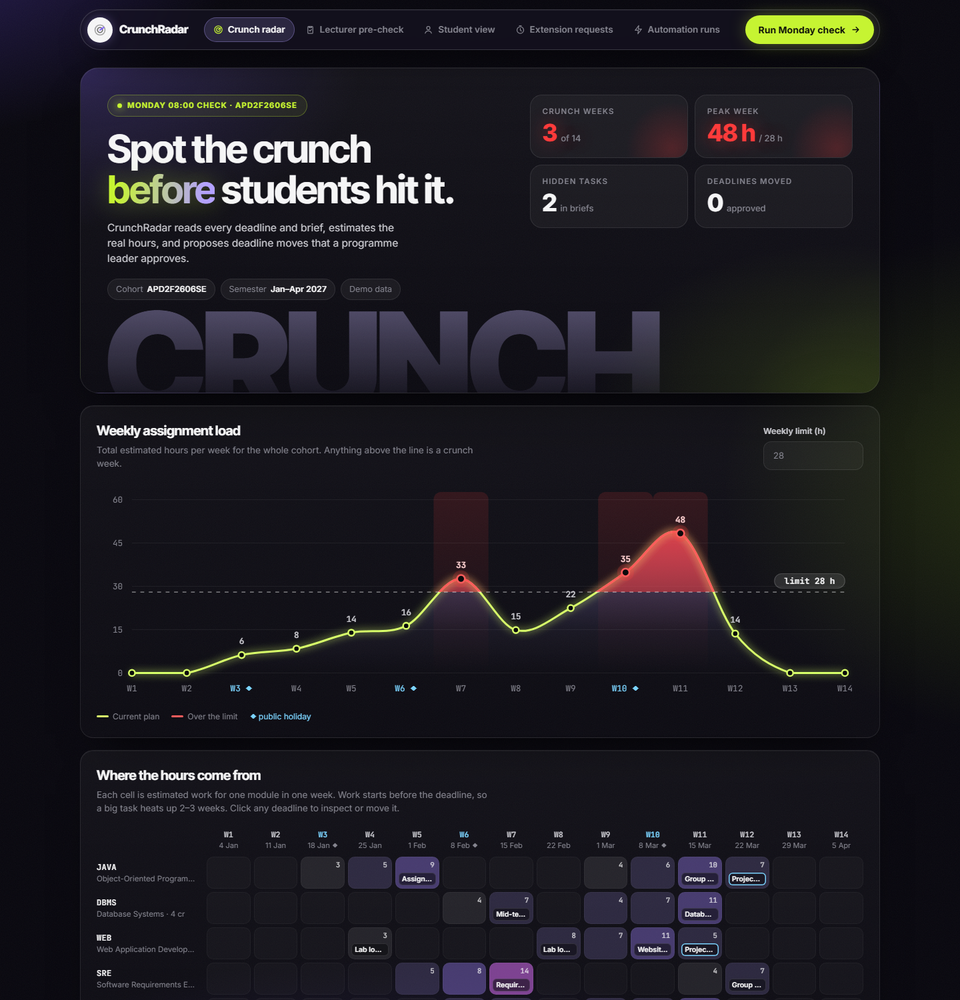

# CrunchRadar

**Spots crunch weeks before students hit them, and fixes them with a human in the loop.**

APU Cloud Innovation Hackathon 2026 · Theme: Intelligent Automation & Digital Transformation

> **The working system is in [`system/`](system/README.md)**: a scheduled workflow agent with real connectors, an approval step, follow-up and 27 tests. `index.html` is the demo face of the same rules.

**▶ Live demo: https://joseph-mayala.github.io/crunchradar/** · 📄 [One-page poster (PDF)](docs/poster.pdf)

> **What this repo contains (13 Nov prototype round).** A working web prototype running on demo data. As the organisers announced, the prototype round does not need Gemini Enterprise, so this version is not built with it yet. If we reach the top 5, we will rebuild CrunchRadar as Gemini Enterprise workflow agents for the 17 Nov final. That plan is set out in [Plan for the final](#4-plan-for-the-final-17-nov-gemini-enterprise).

---

## 1. The problem

Each lecturer sets deadlines on Moodle for their own module, without seeing the other modules. So a cohort gets 4–5 assignments and tests in the same week, then nothing for weeks.

- **Crunch weeks.** Quality drops and stress rises when several big tasks land together.
- **Hidden tasks.** Presentations and vivas are written inside assignment briefs but never appear on the Moodle calendar.
- **Festive weeks.** Deadlines land during Chinese New Year or Hari Raya.
- **No time for feedback.** The next assignment is due before marks on the last one come back.

Nobody owns the whole cohort's calendar, so nobody sees the overload until students are already in it.

## 2. The solution

CrunchRadar measures **hours of work per week**, not just the number of deadlines. It reads each assignment brief, estimates the effort, spreads that work over the weeks before the deadline, and compares the weekly total with a limit.

**How the limit is set.** The limit comes from Malaysia's Student Learning Time rule (MQA: 1 credit = 40 hours of student effort):

| | |
| --- | --- |
| 21 credits × 40 h | 840 h per semester |
| Spread over 14 weeks | ≈ 60 h per week |
| Minus classes | − 20 h |
| Minus revision and reading | − 12 h |
| **Assignment work limit** | **≈ 28 h per week** |

When a week goes over the limit, CrunchRadar proposes pushing one deadline 1–2 weeks later. It:
- never moves a deadline earlier,
- never moves fixed test dates,
- skips festive weeks and the revision week before finals,
- never breaks the feedback rule.

**A programme leader approves every change.** Weeks that one move can't fix are escalated to them with options.

## 3. The prototype (13 Nov round)

**Try it:** https://joseph-mayala.github.io/crunchradar/ (works on phones; no sign-in needed).

**What it is:**
- One web page (`index.html`).
- Runs entirely in the browser on **sample data**: six modules from the APD2F2606SE programme, with 16 made-up assessments and tasks (2 of them hidden in briefs) and a Jan–Apr 2027 semester. Holiday dates are approximate.
- No real Moodle data is read and no real emails are sent. When an approval would send an email, the page shows the drafted email instead.
- Your changes are saved in your own browser, so they survive a refresh. "Start the demo over" at the bottom of the page clears them.

**What you can do in it:**

| Tab | Who it's for | What it shows |
| --- | --- | --- |
| **Crunch radar** | Programme leader | Graph of weekly hours against the limit, heatmap of hours per module per week, up to three suggested deadline moves that can each be approved or rejected, the email each approval would send, issues found (crunch weeks, hidden tasks, festive weeks, feedback clashes) |
| **Lecturer pre-check** | Lecturers | Check a draft assignment against the cohort's load and the brief's quality before publishing it, with the lightest nearby weeks |
| **Student view** | Students | Preview of the Monday email digest, a "marks per hour" priority list, and an anonymous "This week is too much" button that alerts the programme leader at 30% of the cohort |
| **Extension requests** | Lecturers | A request is checked against the student's real workload and the policy. A decision is drafted, the lecturer approves it, and the student's email is shown |
| **Automation runs** | Everyone | "Run Monday check now" plays the weekly workflow step by step, with a run history, the drafted emails and a map of the 5 planned workflows |

**Demo path (about 2 minutes):**
1. **Crunch radar:** 3 crunch weeks, peak 48 h. Approve the "Best fix" each time (4 in total), read the drafted email, and watch the peak drop to 32 h.
2. **Lecturer pre-check:** check a new Week 11 assignment and see the warning.
3. **Student view:** preview the Monday digest, then tap "This week is too much" to trigger the escalation.
4. **Extension requests:** draft a decision and approve it.
5. **Automation runs:** press "Run Monday check now".

**How the prototype estimates hours (for now).** It uses a simple formula: a base for each task type, plus extra for word count and weighting, adjusted for group work. Every estimate shows its working. In the final version, Gemini reads the actual brief and explains its estimate.

## 4. Plan for the final (17 Nov): Gemini Enterprise

If we reach the top 5, CrunchRadar becomes a set of **workflow agents inside Gemini Enterprise**. They run on a schedule or on events, with nobody logged in, and stop for a human only when a deadline would change. The prototype's rules (the 28 h limit, the 1–2 week moves, festive and revision weeks, the feedback rule) become the agents' instructions.

### What is real and what is sample in the prototype

| Part | Status |
| --- | --- |
| Rules (28 h limit, 1–2 week moves, no festive/revision weeks, feedback rule) | Real, running in the browser |
| Hour estimates | Real formula on **sample** assessments. Base hours are team assumptions, editable on the Crunch radar tab |
| Brief reader (Lecturer pre-check tab) | **One real Gemini call** when you paste your own API key. With no key, or if the call fails or takes over 8 s, it falls back to a rule-based reader and labels itself "Rules fallback" |
| Approval step | Real stop: every move, email and decision waits for a named person. Rejecting, or a lecturer declining after approval, undoes the move and finds the next option |
| Scheduled run, Moodle/Calendar/Drive/Outlook | **Not connected yet.** "Run Monday check now" plays the steps. Emails are drafted on screen, never sent |

**How AI fits.** The rules are the guardrails and the Gemini agent reasons inside them. Gemini only suggests (tasks, hours, explanations); the rules clamp its output, and nothing changes a deadline without the programme leader. For the 17 Nov final the same rules become the agent's instructions inside Gemini Enterprise.

### The 5 workflows

| Workflow | Trigger | Steps | Human in the loop | Priority |
| --- | --- | --- | --- | --- |
| **Monday crunch check** | Schedule · Mon 08:00 MYT | Read Moodle deadlines (Google Calendar) → read briefs (Google Drive) → Gemini estimates hours and finds hidden tasks → condition: any week over the limit? → propose moves | **Approval:** programme leader → email lecturers (Outlook) → Monday digest to students | **Build first** |
| **Lecturer pre-check** | Manual · `@CrunchRadar` in chat | Read draft brief → check brief quality → compare with cohort load → reply with lightest weeks | — | Second |
| **Extension triage** | Event · new Google Form response | Read request → check student's workload → check policy → draft decision | **Approval:** lecturer → email student | Third |
| **"Too much" pulse** | Event · new Google Form response | Count taps per week → condition: ≥ 30% of cohort? → alert programme leader | — | Fourth |
| **Follow-up** | Schedule · Mon 08:30 MYT | Check approved moves are live on Moodle → condition: not updated? → remind lecturer | — | Fifth |

### Connectors

| Connector | Type | Used for |
| --- | --- | --- |
| Google Calendar | 1P | Moodle deadlines, exported as a calendar feed |
| Google Drive | 1P | Assignment briefs |
| Google Forms / Sheets | 1P | "Too much" taps and extension requests |
| Microsoft Outlook | 3P | Emails to lecturers and students (APU email runs on Outlook) |

### Build order once licences are active

1. Create the Gemini Enterprise app and turn on workflows.
2. Connect Google Drive and Calendar, and load the demo briefs and deadlines.
3. Build the **Monday crunch check**, test it in Preview, then turn it on.
4. Connect Outlook through an Azure app registration, using Google Antigravity for step-by-step help.
5. Add the other four workflows, in the priority order above.
6. Invite the judges into the app (the demo link for the final).

## 5. Research

- **Student Learning Time (MQA):** 1 credit = 40 notional hours of student effort ([MQA curriculum design guideline](https://www2.mqa.gov.my/qad/v2/garispanduan/2019/GGP%20CDD/4.%20GGP%20-%20Curriculum%20Design%20and%20Delivery_BI%20-%20[FB].pdf)). This gives an objective ceiling instead of a guess. The 20 h of classes and 12 h of revision taken off it are **team assumptions**, shown and editable in the prototype.
- **What already exists.** Moodle plugins and dashboards already *aggregate* deadlines for students (counting items, not hours) and some universities write rules against "assessment bunching" that staff check by hand. CrunchRadar's difference is the part those lack: hours against a credit-hour ceiling, a specific proposed move under hard rules, and a named approver. See [docs/POSITIONING.md](docs/POSITIONING.md) for sources still to verify.
- **Still to collect:** one real cohort's deadline list and quotes from a programme leader and two lecturers. Until then the headline numbers are from sample data.

## 6. Impact

**Measured in the prototype (demo cohort):**
- Peak weekly workload: **48 h → 32 h** after 4 approved moves.
- Crunch weeks: **3 → 2**. The remaining weeks are escalated to the programme leader with options.
- **2 hidden tasks** found in briefs that weren't on the calendar.

**What we expect over 3–6 months.** These are targets to measure, not results yet.
- Fewer crunch weeks per semester for each cohort.
- Fewer extension requests and clarification emails to lecturers.
- Less time spent by programme leaders checking calendars by hand.

## Files

| File | What it is |
| --- | --- |
| `index.html` | The prototype (open in any browser) |
| `docs/poster.pdf`, `docs/poster.png` | One-page poster explaining CrunchRadar |
| `docs/poster.html` | Source for the poster |
| `docs/CRITERIA.md` | How each judging criterion maps to a screen or slide |
| `docs/POSITIONING.md` | Competitor comparison, objections and answers, evidence to collect |
| `docs/screenshot-radar.png` | Screenshot of the Crunch radar view |

.
